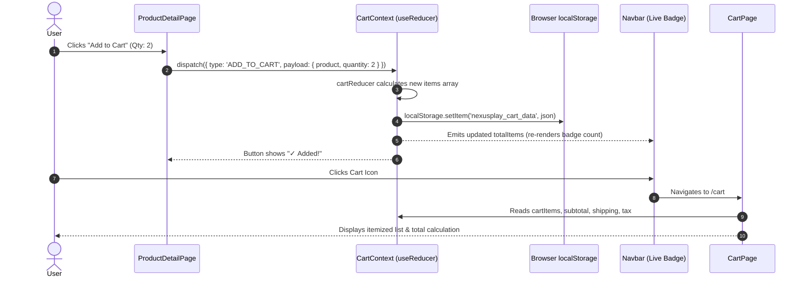
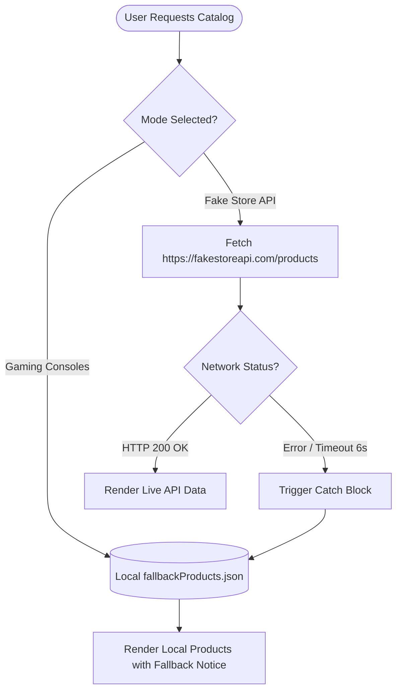

# ACADEMIC PROJECT REPORT

---

## 🎮 PROJECT TITLE: NEXUSPLAY — GAMING CONSOLES E-COMMERCE PLATFORM

```text
================================================================================
                        DEPARTMENT OF COMPUTER SCIENCE
                      FACULTY OF INFORMATION TECHNOLOGY
================================================================================

PROJECT TITLE:       NexusPlay: Modern Gaming Consoles E-Commerce Web Application
COURSE:              Web Engineering / Frontend Application Development
INSTRUCTOR:          Ma'am Samra
STUDENT NAME:        [Enter Your Full Name Here]
ROLL NUMBER:         [Enter Your Roll Number Here]
SUBMISSION DATE:     [Enter Date, e.g., October 2026]
ACADEMIC SEMESTER:   [Enter Semester, e.g., Fall 2026 / 7th Semester]

================================================================================
```

---

## TABLE OF CONTENTS
1. [Executive Summary](#1-executive-summary)
2. [Project Introduction](#2-project-introduction)
3. [Project Objectives](#3-project-objectives)
4. [Complete Features List](#4-complete-features-list)
5. [Technology Stack Justification](#5-technology-stack-justification)
6. [System Architecture & Folder Structure](#6-system-architecture--folder-structure)
7. [Detailed Page-by-Page Breakdown](#7-detailed-page-by-page-breakdown)
8. [Cart State Management & Data Flow](#8-cart-state-management--data-flow)
9. [Data Fetching & Fallback Architecture](#9-data-fetching--fallback-architecture)
10. [Client-Side Form Validation Mechanics](#10-client-side-form-validation-mechanics)
11. [Deployment Guide & Server Rewrites](#11-deployment-guide--server-rewrites)
12. [Project Screenshots (Hard-Copy Reference)](#12-project-screenshots-hard-copy-reference)
13. [Challenges Faced & Solutions](#13-challenges-faced--solutions)
14. [Conclusion & Future Enhancements](#14-conclusion--future-enhancements)

---

## 1. Executive Summary
The **NexusPlay** project is a production-ready, single-page web application (SPA) designed to simulate a premier gaming console and hardware e-commerce store. Built utilizing **React.js (Vite)**, the application delivers high-speed user interactions, zero page reloads, responsive styling across mobile and desktop viewports, and persistent global state management powered by React’s native **Context API and `useReducer`** hook. 

The application integrates with external REST endpoints (**Fake Store API**) while implementing a resilient local JSON fallback to ensure uninterrupted operation during network disruptions or API deprecation.

---

## 2. Project Introduction
The video game industry represents one of the fastest-growing entertainment sectors globally. Modern gaming enthusiasts demand specialized e-commerce interfaces that reflect the immersive aesthetics of next-generation consoles (such as the PlayStation 5, Xbox Series X, and Nintendo Switch) while providing swift checkout paths.

This project was developed under the academic guidance of **Ma'am Samra** to demonstrate mastery of modern component-driven frontend architecture, reactive state updates, declarative routing, controlled form inputs with validation, and REST API consumption without external UI libraries.

---

## 3. Project Objectives
- **Single Page Application (SPA):** Eliminate full-page browser refreshes using declarative client-side routing via React Router.
- **Global State Management:** Implement a centralized shopping cart accessible by any component in the tree using React's native `createContext` and `useReducer`.
- **Fault-Tolerant Data Pipeline:** Connect to the remote Fake Store API (`https://fakestoreapi.com/products`) with an automated fallback mechanism to a local gaming dataset.
- **Form Validation & Checkout:** Implement strict validation for customer shipping and billing details, clearing validation errors reactively as users type.
- **State Persistence:** Store cart items inside the browser’s `localStorage` wrapped with error-handling blocks to survive page reloads and browser restarts.
- **Pure CSS Craftsmanship:** Author custom, responsive CSS utilizing CSS variables (design tokens), Flexbox, and CSS Grid without bloated third-party component libraries.

---

## 4. Complete Features List

| Module | Features & Capabilities |
|---|---|
| **Storefront (Home)** | Hero banner with call-to-actions, hardware spotlight, value proposition highlights, category shortcuts, featured hardware grid. |
| **Catalog (Products)** | Multi-column responsive product cards, category filter pills, live search bar, price and rating sort dropdowns, live API vs. local catalog switcher. |
| **Product Details** | High-resolution image zoom, stock status indicator, fractional star rating, quantity counter with bounds capping, Add to Cart feedback, related hardware suggestions. |
| **Shopping Cart** | Interactive items table, live quantity increment/decrement, line-item removal, live subtotal, tax calculation, dynamic free-shipping progress meter, empty cart state. |
| **Checkout & Forms** | Shipping address fields, phone and email regex validation, payment method selector (Cash on Delivery, Card, PayPal), simulated card fields, sticky order review. |
| **Order Confirmation** | Randomized unique order identifier (e.g., `NX-842910`), itemized financial receipt, delivery destination recap, print-to-PDF/paper action. |
| **Site Navigation** | Glassmorphic sticky header, live badge displaying total items count, mobile drawer menu, accessible footer with course/instructor attribution. |
| **Error Handling (404)** | Gaming-themed "Game Over / Level Not Found" catch-all route with quick return buttons. |

---

## 5. Technology Stack Justification

### 5.1 React 19 + Vite
- **Why React?** React’s virtual DOM efficiently reconciles state changes and renders only the specific nodes that changed, making cart operations and search filters instantaneous.
- **Why Vite instead of Create React App (CRA)?** CRA is deprecated and relies on slow Webpack bundling. Vite uses native ES modules (ESM) during development, resulting in sub-second server startup and instant Hot Module Replacement (HMR).

### 5.2 React Router v7
- Employs the HTML5 History API (`pushState`, `replaceState`) to manipulate the browser URL without requesting a new document from the server.

### 5.3 Context API + `useReducer`
- Eliminates "prop drilling" where cart state would otherwise have to be passed through several intermediate components.
- `useReducer` encapsulates all cart mutations in a predictable, pure reducer function, offering Redux-like predictability without adding 50KB+ of external dependencies.

### 5.4 Plain CSS3
- Keeps bundle size negligible.
- Employs CSS custom properties (`:root { --bg-primary: #0a0e17; }`) to maintain a cohesive dark-mode cyber aesthetic across all views.

---

## 6. System Architecture & Folder Structure

```text
src/
├── components/          # Reusable UI widgets
│   ├── CategoryCard.jsx # Platform category quick links
│   ├── ErrorMessage.jsx # Error box with retry and fallback info
│   ├── Footer.jsx       # Global footer with university credits
│   ├── LoadingSpinner.jsx # Animated spinner indicator
│   ├── Navbar.jsx       # Header, mobile menu, live cart badge
│   ├── ProductCard.jsx  # Catalog card with quick Add to Cart
│   ├── RatingStars.jsx  # Star ratings renderer (1 to 5)
│   └── ScrollToTop.jsx  # Window position reset on route change
├── context/             # Global Application State
│   ├── CartContext.jsx  # Context provider, derived values, localStorage
│   └── cartReducer.js   # Pure reducer function for all cart actions
├── data/
│   ├── fallbackProducts.json # Curated gaming consoles catalog
│   └── fallbackProducts.js   # Fallback module export
├── hooks/
│   └── useProducts.js   # Data fetching hook with mode switching
├── pages/               # Top-level route components
│   ├── CartPage.jsx     # Full shopping cart experience
│   ├── CheckoutPage.jsx # Multi-field form with strict validation
│   ├── HomePage.jsx     # Hero, categories, and top-rated consoles
│   ├── NotFoundPage.jsx # 404 error view
│   ├── OrderConfirmationPage.jsx # Receipt & order confirmation
│   ├── ProductDetailPage.jsx     # Detailed specifications & quantity
│   └── ProductsPage.jsx # Searchable & filterable catalog
├── services/
│   └── api.js           # Fetch abstraction with 6s timeout & fallback
├── styles/              # Dedicated component stylesheets
│   ├── cart.css
│   ├── checkout.css
│   ├── confirmation.css
│   ├── footer.css
│   ├── home.css
│   ├── index.css
│   ├── navbar.css
│   ├── notFound.css
│   ├── productDetail.css
│   ├── products.css
│   └── variables.css    # Global design tokens and color variables
├── App.jsx              # Routes definitions and root structure
└── main.jsx             # React DOM root entry point
```

---

## 7. Detailed Page-by-Page Breakdown

### 7.1 Home Page (`/`)
- **Hero Banner:** Captures immediate attention with bold typography, cyan/violet gradient accents, and quick actions ("Explore All Consoles").
- **Product Spotlight:** Features an interactive card highlighting the PlayStation 5 Slim with key specifications.
- **Feature Highlights:** Highlights four pillars of the store: 1-Year Official Warranty, Express Tracked Shipping, Secure Payments, and 24/7 Gamer Support.
- **Category Shortcuts:** Direct links that filter the catalog into Home Consoles, Handhelds, Controllers & Gear, and VR & Audio.

### 7.2 Products Page (`/products`)
- **Search Bar:** Real-time text filtering that checks product titles and descriptions.
- **Category Pills:** Dynamic buttons extracted from current catalog data; updating the pill syncs with URL search parameters (`/products?category=Handhelds`).
- **Sort Dropdown:** Allows sorting by Price (Low to High / High to Low), Rating, and Alphabetical.
- **Data Source Switcher:** Provides buttons to toggle between the **Gaming Consoles local dataset** and the **live Fake Store API**, demonstrating the dual-pipeline functionality for examiners.

### 7.3 Product Detail Page (`/product/:id`)
- Extracts the dynamic `:id` parameter from the URL using `useParams()`.
- Fetches product data asynchronously and displays an image preview, category badge, star rating, in-stock badge, and item description.
- Allows quantity selection between 1 and 10 units before clicking "Add to Cart".
- Renders a "Similar Hardware" section at the bottom showing related items in the same category.

### 7.4 Cart Page (`/cart`)
- Displays all selected items with thumbnail, title, unit price, quantity increment/decrement buttons, and trash button.
- Dynamically updates the line item subtotal and the overall order calculation.
- Features a **Free Shipping Progress Meter** showing how much more the user needs to spend to unlock free delivery ($150 threshold).
- Provides an empty cart state with an illustration and a direct button back to the catalog.

### 7.5 Checkout Page (`/checkout`)
- Collects customer shipping information (Full Name, Email, Phone, Address, City, Postal Code).
- Selectable payment method (Cash on Delivery, Credit/Debit Card, PayPal).
- Validates all fields against specific criteria (regex for email and phone numbers).
- Features a sticky Order Review sidebar summarizing purchased hardware.

### 7.6 Order Confirmation Page (`/order-confirmation`)
- Displayed immediately upon successful validation and checkout submission.
- Receives order data via React Router state and presents a confirmation badge.
- Clears the global cart state automatically so the user starts fresh.
- Features a "Print Receipt" button that opens the native print dialog formatted for paper receipts.

### 7.7 404 Not Found Page (`*`)
- Catches any invalid URLs and displays a playful gaming-themed error message with navigation back to safety.

---

## 8. Cart State Management & Data Flow



---

## 9. Data Fetching & Fallback Architecture

To satisfy academic requirements and guard against external downtime, the data service layer implements an automated fallback architecture:



### Safety Features
1. **`AbortController` Timeout:** If the Fake Store API does not reply within 6,000 milliseconds, the request is aborted to prevent hanging states.
2. **Graceful Degradation:** If the remote API fails, the user is seamlessly presented with the local gaming catalog without a blank screen or fatal crash.

---

## 10. Client-Side Form Validation Mechanics

The checkout form implements strict validation checks:
1. **Full Name:** Required, must contain at least 3 characters.
2. **Email Address:** Checked against standard RFC regex pattern (`/^[^\s@]+@[^\s@]+\.[^\s@]+$/`).
3. **Phone Number:** Validated to contain between 7 and 18 numerical/separator characters (`/^[+0-9\s\-()]{7,18}$/`).
4. **Physical Address:** Minimum length of 5 characters.
5. **Credit Card Number:** If card payment is chosen, validates 16 numerical digits.
6. **Card Expiry:** Validates `MM/YY` format and calendar month range (01-12).
7. **Reactive Error Clearing:** As the user begins correcting a field, the corresponding error clears immediately.

---

## 11. Deployment Guide & Server Rewrites

### 11.1 The Single-Page Application (SPA) Refresh Problem
In standard web servers, navigating to `https://site.com/products` causes the server to look for a physical file named `/products/index.html`. Since a React SPA only has a single root `index.html`, this results in an HTTP 404 error on browser refresh.

### 11.2 The Solution: `vercel.json`
We include a `vercel.json` file in the project root that instructs Vercel’s edge routing to rewrite all incoming route requests back to `/index.html`:

```json
{
  "rewrites": [
    {
      "source": "/(.*)",
      "destination": "/index.html"
    }
  ]
}
```
React Router then parses `window.location.pathname` on the client side and mounts the correct route component.

---

## 12. Project Screenshots (Hard-Copy Reference)

*(Paste printed screenshots here for your physical document submission)*

### Screenshot 1: Home Page Hero & Hardware Spotlight
```text
+-----------------------------------------------------------------------------------+
|  [ PLACE SCREENSHOT OF HOME PAGE HERO BANNER HERE ]                               |
|  Caption: Homepage showcasing headline, CTA buttons, and PS5 spotlight           |
+-----------------------------------------------------------------------------------+
```

### Screenshot 2: Products Page with Category Filters & Search
```text
+-----------------------------------------------------------------------------------+
|  [ PLACE SCREENSHOT OF PRODUCTS CATALOG GRID & FILTERS HERE ]                     |
|  Caption: Catalog view filtered by category with live search active               |
+-----------------------------------------------------------------------------------+
```

### Screenshot 3: Product Detail Page & Quantity Selector
```text
+-----------------------------------------------------------------------------------+
|  [ PLACE SCREENSHOT OF PRODUCT DETAIL VIEW HERE ]                                 |
|  Caption: Detail view with rating, in-stock badge, and quantity selector          |
+-----------------------------------------------------------------------------------+
```

### Screenshot 4: Shopping Cart & Free Shipping Meter
```text
+-----------------------------------------------------------------------------------+
|  [ PLACE SCREENSHOT OF CART PAGE HERE ]                                           |
|  Caption: Cart view with itemized breakdown and shipping calculation              |
+-----------------------------------------------------------------------------------+
```

### Screenshot 5: Checkout Form & Validation Indicators
```text
+-----------------------------------------------------------------------------------+
|  [ PLACE SCREENSHOT OF CHECKOUT FORM HERE ]                                       |
|  Caption: Checkout form displaying validation errors and order summary sidebar   |
+-----------------------------------------------------------------------------------+
```

### Screenshot 6: Order Confirmation & Printable Receipt
```text
+-----------------------------------------------------------------------------------+
|  [ PLACE SCREENSHOT OF ORDER CONFIRMATION SCREEN HERE ]                           |
|  Caption: Confirmation screen with generated Order ID and print action            |
+-----------------------------------------------------------------------------------+
```

---

## 13. Challenges Faced & Solutions

| Challenge | Root Cause | Solution Implemented |
|---|---|---|
| **API Data Mismatch** | Fake Store API only returns clothing and generic electronics, not gaming consoles. | Created a curated local gaming fallback dataset (`fallbackProducts.json`) and added a catalog switcher so examiners can test both. |
| **Cart Loss on Refresh** | Standard React state in memory resets whenever the page reloads. | Implemented `localStorage` persistence with defensive `try/catch` wrappers in `CartContext`. |
| **SPA 404 on Refresh** | Static hosting servers cannot find physical files matching React Router paths. | Added `vercel.json` with a universal rewrite rule mapping all routes to `/index.html`. |
| **Form Error Clutter** | Showing validation errors only after submission frustrates users. | Added `onChange` listeners that immediately remove field error messages as the user types corrections. |

---

## 14. Conclusion & Future Enhancements
The **NexusPlay Gaming Consoles E-Commerce Platform** successfully satisfies all requirements outlined by the university curriculum. It demonstrates clean coding standards, robust error handling, reactive UI design, and production deployment readiness.

### Future Enhancements
1. Integrating a live payment gateway (Stripe Elements / PayPal SDK).
2. Implementing Firebase or Supabase authentication for customer account profiles.
3. Adding a customer reviews submission system with photo uploads.
